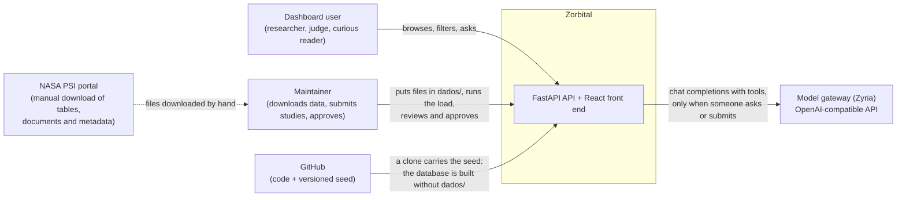
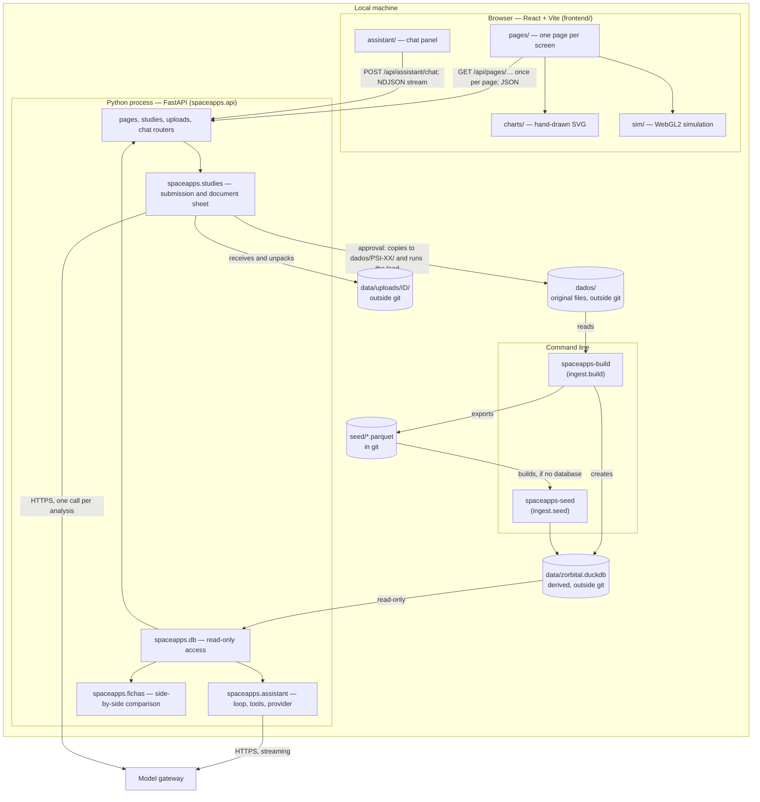

# Architecture

Zorbital is a local application in two parts — a Python API over a deterministic data pipeline, and
a React front end that does the drawing in the browser — plus three narrowly scoped uses of a
language model, each gated by code and by a person. This page describes the pieces, how they talk,
and the principles that hold across all of them.

## Quality goals, in order

When two conflict, the one above wins.

1. **Traceability.** Every number on screen and every interpretation has a named origin: file, sheet
   and line; document and page; or "inferred" with the reviewer's confirmation.
2. **Reproducibility.** The same input folder produces the same database and the same seed, with no
   AI in the path.
3. **Separation of evidence.** Measured, simulated and uncertainty never enter the same average;
   investigations are only crossed on the comparison pages.
4. **Contained AI.** The model proposes; deterministic code validates and applies; a person approves.
   The assistant's scope is enforced in code, not in the prompt.
5. **Honesty about the data.** A cell that cannot be read becomes an alert carrying the original
   value, never a silent correction.
6. **Hostile input handled as such.** Uploaded archives and document contents are data, never
   instructions or trusted paths.

## Context



Three facts shape everything: the PSI portal has no API used here, so a person downloads the files
(hence the seed); the model is an external service paid per token, so it never runs in the load,
the tests or anything that must be reproducible; and there are two roles, the reader and the
maintainer (one person in this version).

## Containers

Everything runs on the user's machine: a Python process (the API; in production it also serves the
built front end) and the browser.



| Container | Responsibility | Technology |
|---|---|---|
| Load (`spaceapps-build`) | inventory `dados/`, choose sources, read each format, build the database, compute the fact sheets, export the seed | Python, Polars, DuckDB, openpyxl |
| Seed (`spaceapps-seed`) | build the database from the versioned Parquet files, without `dados/` | DuckDB |
| API (`spaceapps.api`) | one JSON payload per page with typed tables; studies, sheets and search; submission endpoints; the assistant as an NDJSON stream; serves `frontend/dist` in production (`spaceapps-serve`) | FastAPI, uvicorn |
| Front end (`frontend/`) | pages, filters, charts and counts in the browser; the study hub; the 3D simulation view; the assistant panel; English by default, Portuguese in settings | React 19, Vite, TypeScript, TanStack Query, React Router; SVG and WebGL2 written by hand |
| Assistant | chat per page with closed-scope tools | `openai` SDK pointed at the gateway |
| Study submission | receive files, ask the model for a proposal, validate, review, approve | pypdf, zipfile/tarfile, `7z` |
| Fact sheets and comparisons | common attributes, linked conditions, side-by-side verdicts | Polars |

How the two parts talk: each page makes **one** request (`GET /api/pages/<page>`) and receives its
tables with column types; filters, charts and counts then run in the browser, cached by TanStack
Query, so moving a filter never goes to the server. The database only changes when a submission is
approved, and approval invalidates the cache. The PSI-142 page fetches one digitized set at a time.
Side-by-side sheets are computed on the server. The submission flow keeps its state in the upload
folder on disk (`PUT /api/envios/<id>/especificacao` saves each review edit and returns the checks
and the preview), so reloading the page continues where it stopped. The assistant streams NDJSON
events (`studies`, `tool`, `text`, `done`, `error`); the server keeps no conversation, the history
lives in the browser tab, one per page.

The dependency rule: nothing in `ingest/` imports from the API, the front end or the assistant, and
nothing in `ingest/` calls the model. `studies/` is the only bridge between the model and the load,
and it passes through a file on disk (`estudo.json`, `ficha.json`) approved by a person.

## The load, step by step

```mermaid
sequenceDiagram
    participant P as Maintainer
    participant B as ingest.build
    participant L as readers (flex, bass, cfi, …, generic)
    participant F as ingest.ficha
    participant D as DuckDB
    participant S as ingest.seed
    P->>B: uv run spaceapps-build
    B->>B: inventory: hash of every file, canonical name, duplicates
    B->>B: choose sources: per reader, the highest-priority file (original beats sample)
    loop for each chosen source
        B->>L: load(file, companion)
        L-->>B: typed tables + alerts (unreadable cell → alert, never a fix)
    end
    B->>L: generic.apply(estudo.json) for each submitted study
    B->>B: links: which PSI-117 measurements are CFI flights
    B->>F: compute(tables, catalog, column dictionary, document sheets)
    F-->>B: fact sheets, linked conditions
    B->>F: mark divergences: document × data → alert, never a fix
    B->>D: CREATE TABLE per frame; CREATE VIEW only when its tables exist
    B->>S: export: Parquet (zstd), only what changed
```

Order matters: inventory before choosing sources (duplicates are decided by hash); catalog readers
before submitted studies; submitted studies before the fact sheets (they read the column dictionary);
sheets before divergence marking; tables before views; database before seed.

## A question to the assistant

```mermaid
sequenceDiagram
    participant P as User
    participant W as chat widget
    participant A as assistant.agent
    participant T as assistant.tools
    participant Z as Model
    participant D as db (read-only)
    P->>W: question, on page X
    W->>A: POST /api/assistant/chat (screen state of page X, history, question, language)
    A->>Z: check_model: does the model support tools? (cached catalog)
    A->>A: schemas = tools_for(page X) — only this page's groups
    A->>D: fact sheets of the studies involved (question, evidence, source, cautions) → into the prompt
    A-->>W: "studies" event (the panel shows which sheets were read)
    loop up to 6 rounds
        A->>Z: chat.completions (system = rules + active groups + study sheets + screen summary; last 10 questions)
        Z-->>A: streamed text and/or tool_calls
        alt the model called tools
            A->>T: execute(name, args, Screen)
            T->>T: tool allowed on this page? known parameters? investigation allowed?
            T->>D: fixed query (no free SQL; ≤ 50 rows, ≤ 12,000 chars)
            T-->>A: JSON (or {"error": …} returned to the model)
        else text only
            A-->>W: answer + cost
        end
    end
```

## How the model is used

Three independent uses. They never talk to each other; deterministic code and a person coordinate.

```mermaid
flowchart TB
    subgraph A1["1 · Assistant (per page)"]
        direction LR
        H1["User asks"] --> AG["Model"]
        AG <-->|up to 6 rounds| TR["Tool router<br/>page groups · closed parameters ·<br/>page's investigation only"]
        TR --> RO[("database, read-only")]
        AG --> R1["Answer with cost"]
    end
    subgraph A2["2 · Reading-spec proposer (submission)"]
        direction LR
        IN["table profiles + document text"] --> PM["Model"]
        PM -->|propose_study| VAL["Deterministic validator"]
        VAL -->|problems, up to 2 times| PM
        VAL --> HR["Human review<br/>confirms inferences"]
        HR --> AP["approve → estudo.json"]
        AP --> GR["Generic reader<br/>(every load, no AI)"]
    end
    subgraph A3["3 · Document-sheet proposer"]
        direction LR
        DOC["document text + what the data already says"] --> FM["Model"]
        FM -->|propose_sheet, with quotes| QC["Quote checker<br/>is the quote on that page?"]
        QC --> HR2["Human review<br/>checks what enters"]
        HR2 --> FJ["ficha.json → load"]
    end
```



| Use | Input | Output | Who checks the output | Who may write |
|---|---|---|---|---|
| Assistant | question + screen summary | text | nobody, but every number comes from a tool, and tools are fixed queries | nobody: the database is opened read-only |
| Reading-spec proposer | sheet profiles (12 sample rows each) + documents (≤ 120k chars) | JSON spec | the validator (structure, headers, units, evidence), then the reviewer | only `approve`, after review |
| Document-sheet proposer | documents + the data-derived sheet | JSON sheet | the quote checker (quote found on page ±1), then the reviewer | only the reviewer's approval |

The patterns, named: **narrow typed tools** (no SQL, paths or URLs); **a router with permission
checks outside the prompt** (a tool from another page is refused even if the model invents it;
the refusal goes back to the model as a result); **a deterministic verifier** (the model never grades
its own output); **a human gate, not a human spectator** (inferences start unconfirmed and block
approval; unverified quotes start unchecked; approval is an explicit click that writes a dated
file); **propose vs. apply** (if the model disappeared tomorrow, the system would keep reading the
same files the same way); **content is data, not instructions** (nothing a document could "ask" the
model has an effect, because the only available action is returning the JSON).

What it is **not**: there is no agent calling another agent, no open-ended planning (6 rounds, a
closed tool set; one call plus two corrections for the proposers), no memory across sessions, and
no path from the model to the database, to `dados/` or to the seed that does not pass through a
person.

## Cross-cutting rules

- **One source of truth per concept.** Data: the files in `dados/`. What an investigation is: the
  catalog (`ingest/catalog.py`) or its approved `estudo.json`. What a column means: the data
  dictionary or `estudo_colunas`. Common vocabulary of attributes and measured quantities:
  `ingest/ficha.py`. Everything else is derived.
- **Nature and evidence.** Every data column has a nature (`IDENTIFICADOR`, `CONDICAO`, `MEDIDO`,
  `SIMULADO`, `INCERTEZA`, `DERIVADO`, `TEXTO`, `IGNORAR`) and every interpretation an evidence type
  (`documento` with file/page/quote, `cabecalho`, `inferido`). Both are shown on screen.
- **Alert, never correction.** Unreadable cells, impossible dates, meaningful zeros and
  document-vs-data divergences become rows in `alertas` with the original value.
- **Determinism and the seed.** The load uses no AI and no network; the seed is the database's
  tables as Parquet, rewritten only when content changes; SQL views are not in the seed and are
  recreated by code so they never diverge from the version in use.
- **Limits.** Assistant: 6 tool rounds, 10 questions of history, 1,500 output tokens, 50 rows and
  12,000 characters per result. Submission analysis: 16,000 output tokens, up to 2 corrections,
  documents cut at 120,000 characters and 80 pages per PDF. Document sheet: 6,000 output tokens.
  Archives: 300 MiB unpacked, 2,000 files, 200:1 ratio on files above 10 MiB, 2 nesting levels,
  no paths escaping the folder, no links.
- **Colors follow the entity.** Filtering a category never recolors the others; at most 8 series per
  chart; domain categories (outcome, flame type, material, fuel) have a fixed color on every page.

## Code map

| Path | Responsibility |
|---|---|
| `src/spaceapps/api/` | `app.py` (FastAPI app, database bootstrap from the seed, production server), `pages.py` (one payload per page, explore sources), `studies.py` (hub, generic study page, side-by-side), `uploads.py` (study and document submission: receive, analyze, review, approve), `chat.py` (assistant as NDJSON stream), `frames.py` (tables → JSON with column types) |
| `frontend/src/` | `pages/` (one per screen: overview, study hub and generic study page, FLEX, CFI, PSI-117, BASS-II, PSI-142, side-by-side sheets, PSI-117 × CFI, submit study, add documents, explore), `charts/` (SVG charts, fixed category colors, pure series builders), `sim/` (WebGL2 engine, scenes, burn replay, per-study binding, HUD), `assistant/` (panel, stream client, screen state), `components/`, `styles/`, `api/` (client and types), `lib/` |
| `src/spaceapps/ingest/` | `catalog.py` (what each investigation and file is), `build.py` (the load), one reader per format, `generic.py` (reader for submitted studies), `ficha.py` (fact sheets, linked conditions, vocabulary), `links.py` (PSI-117 × CFI match), `metadados.py` (PSI metadata), `seed.py` |
| `src/spaceapps/studies/` | `archive.py` (safe extraction), `staging.py` (receive), `profile.py`, `documents.py`, `propose.py` (reading-spec proposal), `ficha_docs.py` (document sheet: proposal, quote check, approval), `approve.py` |
| `src/spaceapps/assistant/` | `screen.py`, `tools.py` (24 tools in 11 groups; scope enforcement), `agent.py` (the loop), `provider.py` (gateway client, errors, model check), `dictionary.py` |
| `src/spaceapps/` | `db.py` (read-only), `fichas.py` (side-by-side), `search.py`, `data.py` (explore sources) |
| `tests/` | synthetic `dados/` folder and 114 Python tests (load, seed, API, uploads API, assistant, submission, sheets); a local HTTP server stands in for the gateway. Front-end tests: 7 Vitest files (48 tests) under `frontend/src/**/*.test.ts` |
| `seed/` | 21 Parquet files and a manifest |

## Known limitations

- The **Explore** page aggregates any column of any table without looking at its nature; it is an
  inspection tool and can produce meaningless averages. Replacing it with a table catalog is pending.
- FLEX is loaded from the 34-test sample of the challenge package; the full table (~274 tests) was
  not downloaded.
- Four PSI-117 tables listed in its ReadMe have no reader yet.
- One maintainer, no accounts or queue: submissions are files on the maintainer's machine.
- Submission layouts supported: a simple table, and several sheets with the same columns stacked.
  Side-by-side blocks and key-linked sheets still need a hand-written reader.
- Comparisons suggested by the model during a submission are stored but not verified by rules.
