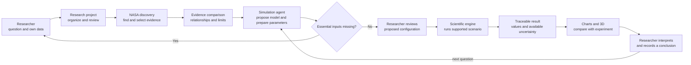
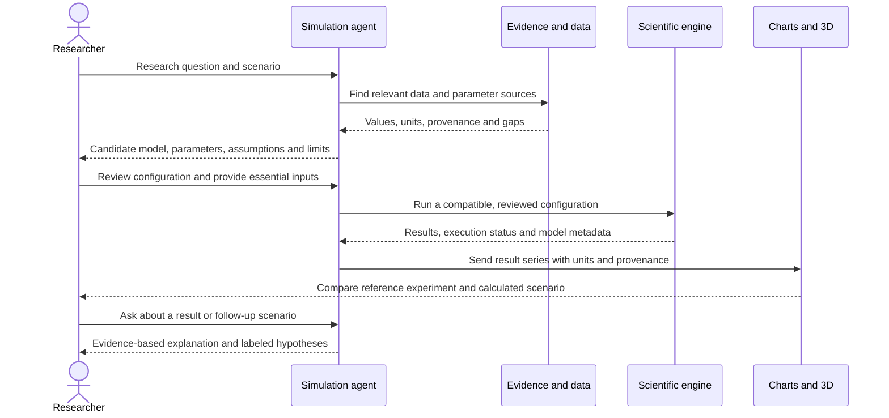
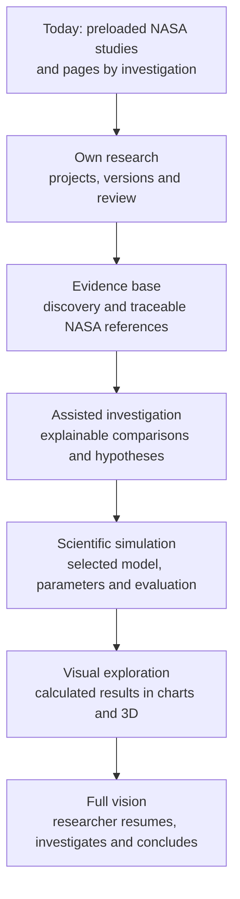

# Product vision — user research, NASA evidence and scientific simulation

Zorbital's vision for NASA Space Apps starts with the user's own research. NASA studies provide
external evidence; scientific simulation helps researchers investigate new scenarios. This page
presents the product we want to build and distinguishes that direction from the capabilities
available in the current prototype. See [ARCHITECTURE.md](ARCHITECTURE.md) for the implementation,
[REQUIREMENTS.md](REQUIREMENTS.md) for the requirements baseline and [SIMULATION.md](SIMULATION.md)
for the proposed first 3D scenario experience.

## Purpose

Zorbital is an AI-assisted research platform centered on the user's own work. Scientists, engineers
and other researchers bring their data, documents and questions. The platform helps organize a
research project, find related NASA studies, connect evidence and explore new scenarios through
scientific computation and 3D visualization.

A specialized scientific simulation agent turns a research question into a proposed virtual
experiment. It identifies suitable models, prepares parameters from the research and references,
asks for essential missing information, conducts calculations through scientific tools and helps
organize the evaluation. This agent is part of the product vision; it is not implemented today.

AI helps researchers reach their own conclusions: it explains relationships, presents supporting
and conflicting evidence, proposes hypotheses and surfaces gaps. The researcher evaluates the
evidence and authors the scientific conclusion. Results can be factual or calculated without
making the AI itself the source of scientific numbers.

NASA is an external evidence source, not a prerequisite for a user's research to exist. A research
project must have its own identity and work without a PSI identifier or an existing NASA match.
The six investigations currently included in the repository are a demonstration and reference set.

Combustion is the initial domain represented in the repository. Supporting other phenomena requires
appropriate data, models and evaluation; the vision does not promise a universal simulator for any
uploaded research.

## The ideal research journey

1. **Start with the research.** The user creates a project with a question, experimental data and
   available documents. Zorbital helps clarify variables, units, materials, geometry, protocols,
   conditions and missing information.
2. **Review the data interpretation.** AI proposes what columns and values mean, with evidence.
   The researcher can confirm, edit or reject interpretations. Original files and adopted versions
   remain identifiable.
3. **Find related work.** Based on the research question and experiment, Zorbital searches
   configured NASA sources. It explains each result's relevance and distinguishes a citation or
   metadata record from research data the system can actually access.
4. **Connect evidence.** The researcher explores similarities, differences, conflicting results,
   limitations and possible analyses across their own work and selected references.
5. **Prepare a simulation.** The user describes the scenario. A specialized agent proposes a
   grounded approach, prepares parameters and explains assumptions, compatibility and gaps. The
   researcher reviews choices that affect the investigation.
6. **Run and explore a scenario.** The user changes a condition, such as pressure or gravity, when
   the selected model supports it. The agent conducts the calculation through the scientific
   engine, then presents results in values, charts and 3D alongside the reference experiment.
7. **Draw a conclusion.** The researcher examines evidence and hypotheses, records an interpretation
   and decides what additional experiment or analysis may be needed.

The agent should reduce the setup burden without hiding the model, parameter sources or open
assumptions. If required information is missing or a scenario is outside the model's supported
scope, Zorbital explains the limitation instead of presenting an animation as a calculated
prediction.

## Example: from the research question to a virtual experiment

This is the future experience, not a claim about what the prototype can currently do.

A researcher uploads tables and a report from their combustion experiments and asks: **“How do my
results relate to NASA studies, and what might change if I reduce the pressure?”** Zorbital profiles
the data and presents fuels, geometry, conditions, measured quantities and units for review. The
research project receives its own identity, independent of NASA identifiers.

Zorbital searches configured NASA sources and explains why each result may be relevant. It shows
which conditions overlap, which differ and whether the underlying data is available. The researcher
selects references to use in the investigation; finding a paper does not imply access to its data.

The simulation agent proposes a candidate model, references, required inputs, parameters already
identified and relevant assumptions. It asks only for essential information that it cannot obtain
with adequate provenance. The researcher can inspect details and review the proposed configuration.

If the selected model supports the scenario, Zorbital calculates the reference condition and the
changed condition. When suitable observations exist, it compares the model with those experiments
and makes clear which observations were used for calibration and which for evaluation. Values,
charts and coordinated 3D scenes show the original evidence and the calculated result.

The researcher can ask, **“What could explain this difference? What should I test next?”** The
assistant presents evidence-based explanations and labels hypotheses as hypotheses. References,
configurations and executions remain linked to the project so the researcher can resume the work
and record a conclusion. When a scenario is unsupported, Zorbital explains what model capability or
input data would be needed to investigate it.

## The scientific simulation agent

The agent manages the complexity of preparing a model so researchers can start with a question.
Preparing a model may mean selecting an existing model, configuring it, combining compatible
components or proposing an adaptation. Each choice needs a basis and appropriate evaluation before
its results support a scientific claim.

| Agent step | What the researcher receives |
|---|---|
| Understand the experiment | Phenomenon, objective, known conditions and desired outputs |
| Find and select approaches | Candidate models, references, relevance and limitations |
| Prepare parameters | Values, units and sources; conflicts, assumptions and essential gaps |
| Propose a configuration | Model and version, inputs, fixed and changed conditions, required resources |
| Conduct an execution | Calculation through a scientific tool, run status and detected errors |
| Organize evaluation | Comparison evidence, differences, evaluated domain and available uncertainty |
| Present and iterate | Results for charts and 3D, explanations and possible follow-up scenarios |

The number of internal parameters should not determine how many fields a user must fill in. The
agent prepares the configuration from distinct kinds of information:

- **Experimental data:** extracted from files and confirmed when ambiguous.
- **Reference properties and parameters:** obtained from identified sources or models, with versions,
  units and conditions of applicability.
- **Assumptions and estimates:** labeled with their method and potential impact.
- **Numerical configuration:** prepared for the selected method and recorded for inspection.
- **Essential missing information:** requested from the researcher when it cannot be sourced reliably.

AI can help identify approaches and draft model code. Proposed equations, coefficients or
implementations need references and verification before supporting predictions. A program running
without error is a software check; scientific evaluation is needed to establish whether the model
adequately represents the experiment. Researcher review does not replace that evaluation.

A **scientific model** is the mathematical representation of a phenomenon. A **scientific engine**
is the software that runs a calculation. The **simulation agent** is the AI that prepares and
conducts the work. The 3D view represents the resulting data. The specific discovery service,
scientific engine and agent architecture have not yet been selected.

## What exists today and what must improve

| Area | Current prototype | Future product direction |
|---|---|---|
| Starting point | Browse six preloaded NASA studies | Start a research project with the user's question and data, without requiring a PSI identifier |
| Import | Submit tables and documents to a local catalog for review | Import, version and review datasets as part of a private, resumable research project |
| NASA evidence | Local collection downloaded manually and distributed as a seed | Discover NASA studies from project context; report provenance, coverage and actual data availability |
| Comparisons | Fact sheets and specific comparisons between selected investigations | Relate a user's data to relevant references and explain comparable conditions, differences and limitations |
| Assistant | Context and tools are scoped to the open page | Follow the research project, find sources, explain relationships, prepare questions and interpret results |
| Scientific agent | AI proposes table and document interpretations with checks and review | Propose models, prepare many parameters from sources, identify gaps and organize evaluation |
| 3D visualization | Reconstruct or replay supported studies | Show calculated scenario results alongside original data in coordinated charts and 3D |
| Pressure and gravity | Conditions appear in existing studies; no predictive scenario controls | Change a condition when the selected model supports it and has suitable evaluation |
| History | Imported data lives in the catalog; assistant context is mostly page-scoped | Resume a project with dataset versions, references, configurations, executions and conclusions |

The current system provides a useful foundation in structured data, provenance, reviewed
interpretations, comparisons and 3D rendering. The vision connects those capabilities gradually to
user-owned research, external evidence and calculated results. It does not require replacing the
entire ingestion pipeline or graphics engine at once. See [SIMULATION.md](SIMULATION.md) for the
proposed initial scenario and [REQUIREMENTS.md](REQUIREMENTS.md) for detailed requirements.

## Product evolution path

This is a proposed sequence of product outcomes, without dates or technology commitments. Work on a
bounded simulation can progress against the existing reference collection while the research
project workflow is being designed.

| Stage | Intended outcome | Evidence of completion |
|---|---|---|
| Current foundation | Explore datasets, review imports, inspect fact sheets, comparisons and 3D reconstructions | Existing capabilities and recorded checks described in ARCHITECTURE and VALIDATION |
| Own research | Projects independent of PSI with reviewed, versioned data and persistent context | A researcher can resume the question, dataset versions and interpretations |
| External evidence | Discover NASA studies in the context of the project | Results show source, relevance, coverage and actual data availability |
| Assisted investigation | Relate own data to selected external evidence | Comparisons explain compatibility, hypotheses and limitations |
| First calculated scenario | One bounded scientific model and phenomenon | Reproducible configuration, real execution, results and documented evaluation |
| Simulation agent | Guided preparation for the selected domain | Model recommendation, sourced parameters and targeted questions about essential gaps |
| 3D exploration | Inspect reference experiments beside calculated scenarios | Charts and 3D share the same results, units and provenance |
| Evaluated expansion | Add models, phenomena and supported conditions | Each addition demonstrates data compatibility and scientific evaluation |

Each stage can be delivered and evaluated on its own while preserving the links needed for the full
research journey. [VALIDATION.md](VALIDATION.md) records software checks and identifies future
scientific evaluation needs.

## Product success criteria

These are proposed acceptance criteria for the future product, not capabilities already validated:

1. A researcher can create and resume a research project without a PSI identifier.
2. The user can tell what was read, interpreted, changed during review and left unresolved.
3. A search for related work reports sources, relevance, coverage and data availability; failures,
   partial coverage and zero results are represented as distinct states.
4. Comparisons show which conditions, dependencies and evidence support each relationship.
5. A supported scenario changes a model input and produces a traceable calculated result alongside
   the original experiment.
6. The user can distinguish observations, reconstructions, estimates, hypotheses and predictions in
   charts and 3D.
7. The AI helps formulate and evaluate hypotheses; the researcher can record a conclusion linked to
   the evidence used.
8. The simulation agent prepares a grounded proposal, shows parameter sources and missing inputs,
   and lets the researcher review important choices without manually entering every technical detail.
