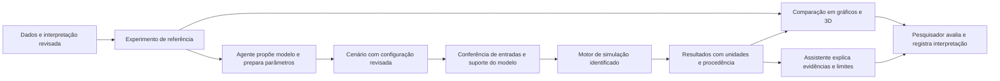

# Agente de simulação e cenários 3D — primeira entrega proposta

**Estado: modelagem da solução.** Este documento define uma primeira experiência para demonstrar
a direção do Zorbital no NASA Space Apps Challenge. A interface de cenários e o motor preditivo
descritos aqui ainda não estão implementados. Hoje existe a reconstrução de estudos suportados.
O cenário ideal e o papel do agente especializado estão em [PRODUCT-VISION.md](PRODUCT-VISION.md).
Este documento detalha o recorte da primeira experiência e suas decisões ainda abertas.

## O que a demonstração deve permitir

Partir de um experimento, criar uma variação de suas condições e investigar o resultado calculado
ao lado da referência original. O usuário precisa conseguir responder: o que alterei, o que foi
mantido, como o resultado foi calculado e que evidência sustenta a comparação?

O recorte inicial proposto é um experimento de gota de combustível, aproveitando as cenas e os
adaptadores de FLEX/CFI existentes. Esse recorte limita a primeira entrega sem limitar a visão do
produto. A seleção final do modelo e das variáveis suportadas ainda está aberta. A proposta é
começar com uma abordagem delimitada, que o agente consiga configurar e explicar com fundamento,
e ampliar as abordagens disponíveis conforme forem avaliadas.

O cenário ideal parte da pesquisa própria. O acervo incluído pode servir como exemplo reproduzível
durante o desenvolvimento e a apresentação; isso não substitui o objetivo de configurar o modelo
a partir dos experimentos enviados pelo usuário.

## Jornada na interface

1. **Escolher a referência.** Abrir um ensaio com seus dados, unidades, procedência e lacunas.
   A demonstração inicial pode usar o acervo incluído. Dados próprios entram quando houver um
   mapeamento revisado para as entradas exigidas pelo modelo; aceitar um arquivo não garante
   compatibilidade com a simulação.
2. **Pedir um cenário ao agente.** O usuário descreve a alteração que quer investigar. O agente
   identifica uma abordagem compatível, prepara uma proposta com parâmetros e origem dos valores
   e solicita informações essenciais ausentes. A referência original permanece disponível.
3. **Revisar a configuração.** O cenário recebe um nome. O usuário informa ou confirma o novo
   valor, vê as demais condições mantidas e revisa hipóteses relevantes propostas pelo agente.
   Pressão e gravidade são os casos de interesse do produto; cada controle depende de suporte
   efetivo do motor, das entradas e do domínio avaliado.
4. **Calcular.** O agente aciona ferramentas que conferem requisitos e executam o modelo. O sistema exibe progresso, resultado
   ou motivo de impossibilidade. Uma configuração pendente não altera a animação como se já
   existisse uma previsão.
5. **Comparar.** A referência e o cenário aparecem em visualizações coordenadas, com valores,
   gráficos e identificação da natureza de cada resultado. O usuário pode pausar e percorrer a
   evolução; a escala física e as unidades precisam ser explícitas.
6. **Investigar com a IA.** O assistente explica o resultado disponível, as hipóteses do cálculo
   e diferenças relevantes. Pode sugerir novas perguntas; o usuário registra sua interpretação.

## Organização da tela

| Área | Conteúdo |
|---|---|
| Referência | Ensaio, fonte, combustível, geometria e condições originais |
| Proposta do agente | Abordagem sugerida, fundamento, parâmetros encontrados, hipóteses e perguntas sobre lacunas |
| Cenário | Nome, parâmetros alteráveis, unidades, valores originais e novos |
| Resultado | Modelo utilizado, estado do cálculo, saídas e limitações |
| Comparação 3D | Referência e cenário identificados; câmera e reprodução coordenadas quando aplicável |
| Evidências | Dados utilizados, reconstruções, hipóteses e eventual avaliação do modelo |
| Assistente | Contexto da referência, alterações e resultados efetivamente calculados |

Uma condição pode ter três estados de interface: **suportada pelo modelo**, **faltam entradas** ou
**ainda não suportada**. Na demonstração do fluxo, controles planejados devem aparecer identificados
como tal. Para apresentar uma simulação funcional, pelo menos uma alteração precisa acionar um
cálculo real e produzir resultados vinculados à configuração.

## Separação entre cálculo e representação

O motor entrega dados de resultado. Os gráficos e o renderizador 3D consomem esses mesmos dados.
A câmera, a aparência da chama e a velocidade da animação não determinam resultados científicos.
O relógio visual deve distinguir tempo físico de progresso ilustrativo ou varredura de curva.

## Informações mínimas de um cenário

| Registro | Informação necessária |
|---|---|
| Referência | Identificador do experimento, versão dos dados e origem |
| Configuração | Valores e unidades de todas as entradas, alterações solicitadas e hipóteses aceitas |
| Modelo | Identificador, versão, fenômeno, entradas e saídas suportadas, domínio e avaliação disponível |
| Proposta do agente | Abordagem escolhida, justificativa, referências, origem dos parâmetros, lacunas e revisões |
| Execução | Identificador, estado, configuração efetivamente usada e erro, quando houver |
| Resultado | Séries e métricas com unidades, natureza prevista e incerteza quando disponível pelo método |
| Comparação | Referência adotada, diferenças calculadas e observações do pesquisador |

Esses registros são o contrato conceitual. O local de execução e o formato definitivo da API
dependem do modelo; a escolha entre navegador e servidor ainda não foi feita.

## Aproveitamento da implementação atual

- `frontend/src/visualization/Simulation.tsx`: controles, seleção, tela cheia e integração com o assistente.
- `frontend/src/visualization/director.ts`: câmera, transições e relógio da reprodução.
- `frontend/src/visualization/engine/` e `scenes/`: renderização e representação do aparato.
- `frontend/src/visualization/types.ts`: estrutura atual de estudos e reproduções, a adaptar para resultados
  de cenários com procedência.
- `frontend/src/visualization/replay/droplet.ts`: reconstrução existente; não constitui um motor capaz de
  prever alterações de gravidade e pressão.

As partes novas são a preparação pelo agente, a configuração de cenários, o contrato do motor,
sua implementação e avaliação, o registro dos resultados e a comparação coordenada. Um envio genérico também precisará de
conferência de compatibilidade com o modelo selecionado.

## Decisão necessária para uma demonstração funcional

É preciso selecionar uma primeira abordagem para o fenômeno escolhido e identificar suas entradas, variáveis
alteráveis, saídas e evidência de avaliação. Não há, nesta modelagem, uma equação escolhida para
converter mudança de gravidade ou pressão em comportamento da chama.

O agente terá critérios para escolher e configurar abordagens suportadas. Um modelo novo ou uma
adaptação produzida com ajuda da IA permanece uma proposta até passar pelas verificações e pela
avaliação necessárias. Registrar apenas que “a IA criou o modelo” não fornece procedência nem
evidência de adequação.

A reconstrução atual, baseada em valores e taxas fornecidos, não justifica inventar essa relação.
Se o primeiro modelo permitir apenas parte das alterações desejadas, a demonstração deve mostrar
essa capacidade com clareza e apresentar as demais como evolução planejada.

## Critérios de entrega

- O cenário original e o alterado permanecem identificáveis e comparáveis.
- A proposta do agente identifica modelo, fontes dos parâmetros, hipóteses e lacunas; campos
  técnicos podem ser preparados automaticamente sem ocultar escolhas relevantes do pesquisador.
- A configuração chega ao cálculo; alterações visuais isoladas não contam como simulação funcional.
- Resultados indicam modelo, entradas, unidades e limitações; campos ausentes não são preenchidos
  pela IA como se fossem medições.
- Os gráficos e o 3D representam o mesmo resultado, com escalas e tempo interpretáveis.
- Configurações sem suporte explicam o impedimento e não exibem uma previsão fabricada.
- A apresentação distingue o que pode ser executado na demonstração da visão de evolução do produto.

Esses critérios descrevem a entrega pretendida; ainda não são verificações concluídas.
